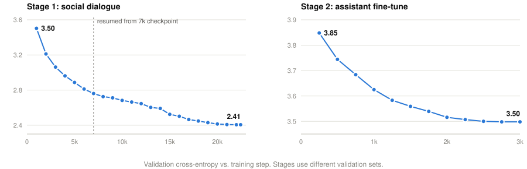

# EG2 Navigator

**Text generation with a frozen embedding model.** A frozen
[EmbeddingGemma 2](https://huggingface.co/google/embeddinggemma-2) encoder (271M parameters)
reads the conversation. A small trained network, the *navigator* (10.5M parameters), writes the
reply. Only the navigator is trained. After about 1.7 hours on a single laptop GPU, the model
holds short, fluent multi-turn conversations.

| | |
|---|---|
| Encoder | EmbeddingGemma 2 text tower, 271M parameters, **frozen** |
| Navigator | 4-layer causal transformer, 10.5M parameters, **trained** |
| Tokens per encoder pass | 16 |
| Training data | about 230k dialogues, 2 stages |
| Training compute | about 1.7 h on one RTX 4060 Laptop GPU (8 GB) |

```
User:  Hi!
Model: Hello! How can I help you today?
User:  What should I cook for dinner tonight?
Model: I'd recommend cooking. What are your favorite dishes?
User:  Thanks, bye!
Model: You're welcome! I hope you enjoy your dinner.
```

More examples, including failure cases, are in [results/demo_transcripts.md](results/demo_transcripts.md).

## Motivation

Text-embedding models are trained to understand text, not to produce it. They are bidirectional
and output vectors, not tokens. This project asks how far that understanding can be reused for
generation: if a pretrained embedding model does all the reading, how small can the trained
generating component be?

## Key terms

The project names its two components after a navigation metaphor.

- **Map.** The per-token hidden states that the frozen encoder produces for the conversation so
  far (768-d per token). They describe where the conversation currently sits in the encoder's
  representation space.
- **Navigator.** The small trainable network that reads the map and writes the reply. It is a
  causal transformer decoder that cross-attends to the map. It chooses each next token by
  pointing into the encoder's own frozen token-embedding table: its output vector is scored
  against every token's embedding. In encoder-decoder terms, it is the decoder of a model whose
  encoder is frozen and whose output layer is tied to that encoder's input embeddings.
- **Chunk.** The navigator writes up to K = 16 tokens per map. During a chunk the encoder does
  not run.
- **Re-encode.** After each chunk the encoder reads the whole conversation again, including the
  navigator's new tokens, and produces a fresh map. This is how a bidirectional encoder supports
  left-to-right generation: one encoder pass per chunk, not per token.

## Method

```
            conversation so far (≤ 384 tokens)
                          │
                          ▼
         ┌────────────────────────────────────┐
         │ EmbeddingGemma 2 encoder (frozen)  │   once per chunk
         └────────────────────────────────────┘
                          │  map: per-token states, 768-d
                          ▼  cross-attention
         ┌────────────────────────────────────┐
         │ navigator (trained, causal)        │   16 steps per chunk
         └────────────────────────────────────┘
                          │  logits = W·h · Eᵀ + b   (E: frozen token-embedding table)
                          ▼
               next 16 tokens ──► append to the conversation and re-encode
```

**Encoder.** The EmbeddingGemma 2 text tower: 24 bidirectional layers of width 512, using
sliding-window attention with full attention every sixth layer. Its normalized, projected
768-d output is the map. It receives no gradients.

**Navigator.** Four pre-LayerNorm blocks of width 384 with 6 heads. Each block applies causal
self-attention over the tokens written so far in the chunk, cross-attention to the map, and an
MLP. The inputs are:

- the navigator's previous tokens, embedded with the frozen table and a learned projection
  (512 → 384);
- the map, with a learned projection (768 → 384) plus a recency embedding that encodes each
  position's distance from the end of the context;
- a learned start vector and 16 learned position embeddings.

**Output.** The navigator projects to the 512-d token-embedding space. Logits are dot products
with the frozen table rows plus a learned per-token bias, computed over the 44,540 tokens that
occur in the training data (17% of the 262k vocabulary).

**Objective.** Each training example cuts a conversation at a random point inside an assistant
turn. Half the time the cut is exactly at the start of a reply, which is the situation at chat
time. The navigator predicts the next 16 tokens. Cross-entropy is computed on assistant tokens
only. Conversations use the format `User: …\nAssistant: …\n`, and generation stops at the
newline.

## Results

Training runs in two stages: fluency on social dialogue, then an assistant-style fine-tune.

| | Stage 1: social dialogue | Stage 2: assistant fine-tune |
|---|---|---|
| Data | [SODA](https://huggingface.co/datasets/allenai/soda) (turns ≤ 30 words) + [DailyDialog](https://huggingface.co/datasets/OpenRL/daily_dialog) ×3 | [everyday-conversations](https://huggingface.co/datasets/HuggingFaceTB/everyday-conversations-llama3.1-2k) ×4 + [Empathetic Dialogues](https://huggingface.co/datasets/Estwld/empathetic_dialogues_llm) |
| Training conversations | 203,511 | 28,571 |
| Steps × batch | about 22.4k × 32 | 3,000 × 32 |
| Learning rate | 3e-4, cosine | 1e-4, cosine, warm start from stage 1 |
| Wall-clock time | about 93 min | about 10 min |
| Validation cross-entropy | 3.50 → **2.41** | 3.85 → **3.50** |

Validation sets differ between stages, so the two cross-entropy values are not directly
comparable. In stage 2 the reported value is the equal-weight mean of the everyday (3.55) and
empathetic (3.44) validation sets.

<picture>
  <source media="(prefers-color-scheme: dark)" srcset="assets/val_curves_dark.svg">
  
</picture>

Stage 1 was interrupted at step 7.7k and continued from the step-7k checkpoint at learning rate
2.4e-4, close to the original cosine schedule at that point, with a freshly initialized
optimizer. The charts are generated from [logs/](logs/) by
[scripts/plot_val_curves.py](scripts/plot_val_curves.py).

<details>
<summary>Validation values</summary>

Stage 1:

| step | 1k | 2k | 3k | 4k | 5k | 6k | 7k | 9k | 11k | 13k | 15k | 17k | 19k | 21k | 22.4k |
|---|---|---|---|---|---|---|---|---|---|---|---|---|---|---|---|
| val CE | 3.503 | 3.211 | 3.062 | 2.962 | 2.887 | 2.812 | 2.761 | 2.712 | 2.664 | 2.603 | 2.524 | 2.465 | 2.430 | 2.408 | 2.406 |

Stage 2:

| step | 250 | 500 | 750 | 1000 | 1500 | 2000 | 2500 | 2750 | 3000 |
|---|---|---|---|---|---|---|---|---|---|
| val CE | 3.848 | 3.744 | 3.684 | 3.625 | 3.559 | 3.516 | 3.500 | 3.498 | 3.498 |
</details>

**Effect of each stage.** Stage 1 produces fluent turn-taking. However, SODA consists of
role-play between named characters, and the stage-1 model sometimes casts itself as a character
in the user's story ("You're going to miss me too, Annalisa"). Stage 2 replaces this with a
consistent assistant voice: greetings, follow-up questions, and supportive replies.

**Limitations.**

- **Little world knowledge.** Factual questions get on-topic but empty answers. "Why is the sky
  blue?" produces a sentence about "light" and "colors" with no explanation.
- **Short coherence span.** The model can lose the thread after two or three turns. The context
  window is 384 tokens.
- **Sampling sensitivity.** Temperature 0.5 gives the most coherent replies. Higher values
  surface more low-probability tokens.
- **Scale.** Training used about 12M target tokens. A generally capable assistant would need a
  much larger navigator and orders of magnitude more data.

## Getting started

Install the CUDA build of PyTorch from [pytorch.org](https://pytorch.org), then install the
remaining dependencies:

```bash
pip install torch --index-url https://download.pytorch.org/whl/cu128
pip install -r requirements.txt
```

Chat in the terminal, or run the scripted five-turn test:

```bash
python eg2_autoregressive_decoding.py --chat --ckpt checkpoints/chat.pt --temp 0.5
python chat_test.py checkpoints/chat.pt
```

Or use the Python API:

```python
from eg2_autoregressive_decoding import ChatBot

bot = ChatBot("checkpoints/chat.pt", temp=0.5)
print(bot.say("Hi!"))
bot.reset()  # start a new conversation
```

The encoder weights download from Hugging Face on first use. Inference runs on CPU or GPU.

## Training

Tested on Windows 11 with an RTX 4060 Laptop GPU (8 GB VRAM) and 16 GB RAM. Peak usage is about
5.5 GB VRAM and 6–8 GB RAM, the latter while tokenizing SODA.

```bash
# Smoke test (about 2 min); use it to measure seconds per step
python eg2_autoregressive_decoding.py --data dialogue --daily 3 --steps 300 --eval_every 300 \
    --max_len 384 --n_stories 20000 --max_turn_words 30 --aux_weight 0 --ckpt test.pt

# Stage 1: social dialogue (about 90 min; steps = 5400 / seconds_per_step)
python eg2_autoregressive_decoding.py --data dialogue --daily 3 --steps 23143 --max_len 384 \
    --n_stories 300000 --max_turn_words 30 --aux_weight 0 --ckpt soda.pt

# Stage 2: assistant fine-tune (about 10 min)
python eg2_autoregressive_decoding.py --data chatmix --init soda.pt --steps 3000 --lr 1e-4 \
    --max_len 384 --eval_every 250 --aux_weight 0 --ckpt chat.pt
```

- A checkpoint is written only when validation cross-entropy improves, so `--ckpt` always holds
  the best model so far.
- `--daily N` mixes DailyDialog into stage 1, repeated N times. `--data chatmix` reports
  validation cross-entropy per source.
- `--aux_weight 0` disables an optional auxiliary loss that predicts the encoder's pooled
  embedding after each chunk. Disabling it halves encoder compute.

## Web demo

The demo is split between a static frontend and a model server:

```
GitHub Pages: docs/index.html  ──── POST /chat ────►  Hugging Face Space: server.py (FastAPI, CPU)
chat + decoding trace          ◄── server-sent events: one per token {"t": text, "p": prob, "c": chunk}
```

The page streams each reply token by token. For every sampled token it shows the token's
probability, as shading and as a bar chart, and it marks each point where the encoder re-reads
the context.

**Run locally**

```bash
pip install fastapi uvicorn
uvicorn server:app --port 7860                    # model server
python -m http.server 8000 --directory docs       # frontend
# open http://127.0.0.1:8000/?api=http://127.0.0.1:7860
```

**Deploy the model server (Hugging Face Spaces).**

Log in with a Hugging Face **write** token, then run the deploy script. It uploads only the files
the server needs. If the Space does not exist it creates a public Docker Space; creating new
Docker Spaces may require a Hugging Face PRO plan, but an existing Docker Space can be renamed
and reused, in which case files from its previous app are removed:

```bash
pip install -U huggingface_hub
hf auth login
python space/deploy.py <hf-user>/<space-name>
```

The [Dockerfile](Dockerfile) installs CPU PyTorch, downloads the encoder at build time, and
serves at `https://<hf-user>-<space-name>.hf.space` (lowercase). `GET /health` reports readiness.

**Deploy the frontend (GitHub Pages).**

1. Set `window.EG2_API` in [docs/config.js](docs/config.js) to the Space URL.
2. In the GitHub repository, open Settings → Pages and deploy from the `main` branch, `/docs`
   folder.

**Server limits.** The server accepts at most 20 turns and 160 new tokens per request, and runs
one generation at a time. To restrict CORS to your Pages domain, set the Space variable
`ALLOWED_ORIGINS`, for example `https://<gh-user>.github.io`.

**Sleep.** A free CPU Space sleeps after 48 hours without requests. The page polls `/health` on
load and waits while the Space starts, which takes about a minute. To keep it awake, the
[keep-warm workflow](.github/workflows/keep-warm.yml) pings `/health` every 12 hours: set the
repository variable `SPACE_URL` (Settings → Secrets and variables → Actions → Variables) to the
Space URL.

## Repository layout

| Path | Contents |
|---|---|
| `eg2_autoregressive_decoding.py` | Model, data loading, training, generation, `ChatBot` |
| `server.py` | FastAPI model server that streams tokens as server-sent events |
| `Dockerfile`, `requirements-server.txt` | Hugging Face Space image |
| `space/README.md`, `space/deploy.py` | Hugging Face Space configuration and deploy script |
| `docs/` | Static frontend for GitHub Pages |
| `chat_test.py` | Scripted five-turn chat test |
| `checkpoints/chat.pt` | Final model: navigator weights, output vocabulary, configuration (40 MB) |
| `logs/` | Training logs: smoke test, stage 1 (two parts), stage 2 |
| `results/demo_transcripts.md` | Sample conversations from both stages |
| `scripts/plot_val_curves.py`, `assets/` | Validation-curve charts, generated from `logs/` |

## Data and licenses

- Encoder: [google/embeddinggemma-2](https://huggingface.co/google/embeddinggemma-2), Apache-2.0.
- Training data: [SODA](https://huggingface.co/datasets/allenai/soda),
  [DailyDialog](https://huggingface.co/datasets/OpenRL/daily_dialog),
  [everyday-conversations](https://huggingface.co/datasets/HuggingFaceTB/everyday-conversations-llama3.1-2k),
  [Empathetic Dialogues](https://huggingface.co/datasets/Estwld/empathetic_dialogues_llm).

Some of these datasets (DailyDialog, Empathetic Dialogues) are licensed for non-commercial use
only. The released checkpoint is therefore intended for research and demonstration. See each
dataset card for its terms.
